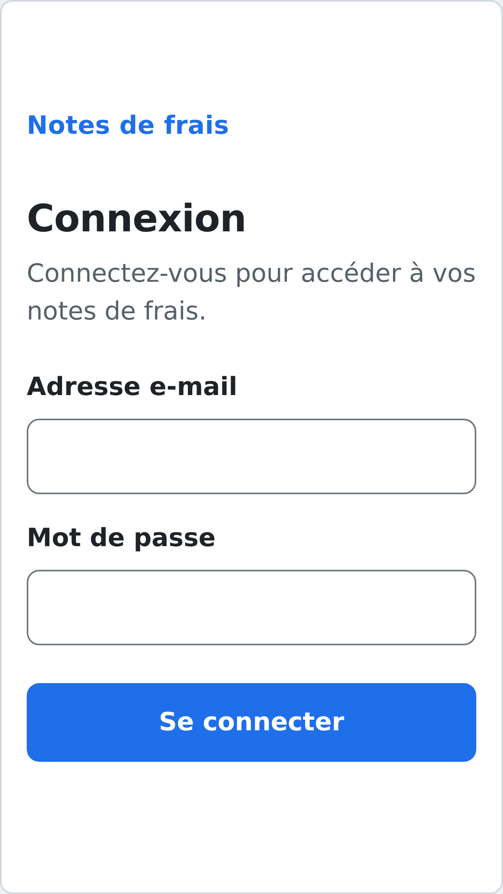
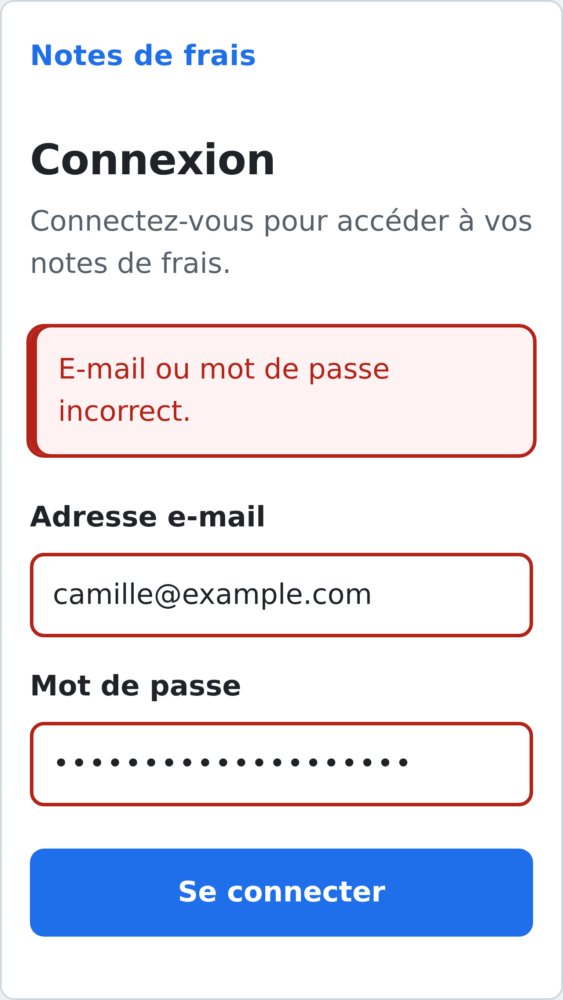
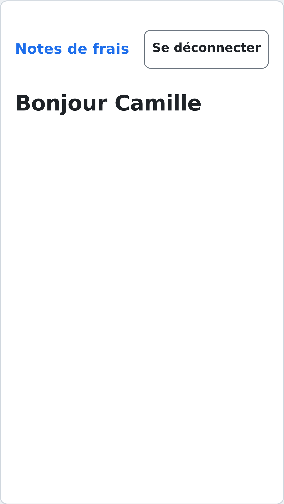
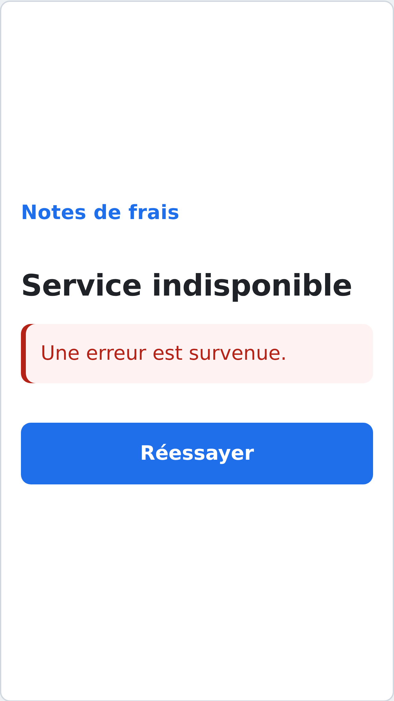
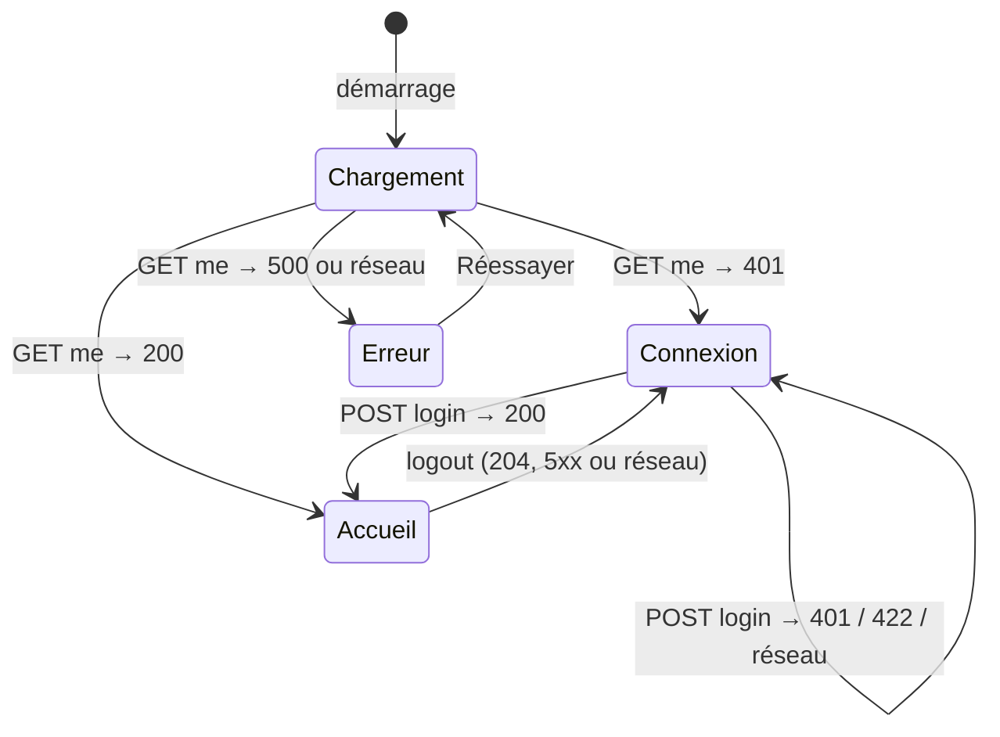

# US-014 — Écrans de connexion et d'accueil

**Carte** : `t_b64867e4` · **Branche** : `agent/us-014` · **Maquette** : [`US-014-maquette.html`](./US-014-maquette.html) (planche des 12 états, ouvrable dans un navigateur)
**Périmètre** : la couche visuelle et les états d'interface de `web/src/App.tsx`, `web/src/pages/LoginPage.tsx`, `web/src/pages/HomePage.tsx`. Le comportement fonctionnel (appels API, transitions) est spécifié par la carte dev ; ce document fixe ce que l'utilisateur voit, lit et atteint au doigt ou au clavier.

| Connexion | Connexion en erreur | Accueil | Erreur de vérification |
| --- | --- | --- | --- |
|  |  |  |  |

Aucune dépendance, aucun framework CSS, aucune police ni image externe dans l'application — les styles vont dans `web/src/index.css`. Les captures ci-dessus et la planche HTML sont des documents de conception, non livrés avec le front.

---

## 1. Parcours

Quatre écrans seulement, sans routeur : un état local dans `App.tsx` décide lequel est monté.



Aucun autre écran : pas d'inscription, pas de mot de passe oublié, pas de page 404 (il n'y a pas de routeur).

Règles de transition visibles :

| Situation | Écran affiché | Détail |
| --- | --- | --- |
| Vérification de session en cours | **1. Chargement** | Rien d'autre à l'écran : le formulaire n'est jamais monté avant la réponse. |
| `/me` → 401 | **2. Connexion** | Sans message d'erreur : une absence de session n'est pas une faute. |
| `/me` → 200 | **3. Accueil** | |
| `/me` → 500 ou `fetch` rejeté | **4. Erreur** | Message de cause + « Réessayer ». |
| `login` → 200 | **3. Accueil** | Le focus part sur le titre de l'accueil. |
| `login` → 401 / 422 / réseau | **2. Connexion**, enrichi | Saisie conservée, alerte affichée, focus sur l'alerte. |
| `logout` (204, 5xx ou réseau) | **2. Connexion**, vierge | Retour inconditionnel ; aucune donnée utilisateur conservée. |

---

## 2. Jetons de couleur (mesurés)

Ratios calculés selon WCAG 2.1 (luminance relative), pas estimés — script de vérification reproductible en annexe E.

| Jeton | Valeur | Usage | Contraste mesuré |
| --- | --- | --- | --- |
| `--couleur-texte` | `#1f2328` | texte courant, titres, libellés | **15,8:1** sur blanc |
| `--couleur-texte-secondaire` | `#57606a` | texte d'introduction, chargement | **6,4:1** sur blanc · 6,0:1 sur `#f6f8fa` |
| `--couleur-fond` | `#ffffff` | fond des écrans | — |
| `--couleur-surface` | `#f6f8fa` | fond des boutons désactivés | — |
| `--couleur-bordure` | `#d0d7de` | séparateurs purement décoratifs | non soumis à 1.4.11 |
| `--couleur-bordure-champ` | `#6e7781` | **limite des champs de saisie** | **4,6:1** (seuil composant : 3:1) |
| `--couleur-primaire` | `#1f6feb` | bouton principal, marque, focus | **4,6:1** sur blanc · blanc sur ce bleu : **4,6:1** |
| `--couleur-primaire-survol` | `#1a5fd0` | survol du bouton principal | 5,9:1 |
| `--couleur-primaire-actif` | `#1559c7` | appui | 6,4:1 |
| `--couleur-erreur` | `#b42318` | texte d'erreur, bordure de champ invalide | **6,6:1** sur blanc · **6,1:1** sur `#fef3f2` |
| `--couleur-erreur-fond` | `#fef3f2` | fond de l'encart d'erreur | — |
| `--couleur-focus` | `#1f6feb` | anneau de focus | 4,6:1 sur blanc · 4,4:1 sur `#f6f8fa` |

Deux points de vigilance :

- **`#1f6feb` est aussi la valeur à mettre dans `theme_color` du manifeste PWA** : la barre du navigateur, la marque et le bouton principal sont alors exactement la même couleur. Si le manifeste en choisit une autre, c'est le jeton qu'il faut changer, pas l'inverse.
- La bordure décorative (`#d0d7de`, 1,45:1 sur blanc) ne doit **jamais** servir de limite à un champ : à ce ratio elle est invisible pour un malvoyant. Un champ prend `--couleur-bordure-champ`.

Pas d'état `:focus` sans anneau, pas de `outline: none` global.

---

## 3. Écran 1 — Chargement (vérification de la session)

Le premier écran vu au démarrage, sur une session existante comme sur une session absente. Il dure le temps d'un aller-retour réseau.

**Composition** : une seule ligne de texte, centrée verticalement et horizontalement.
**Composants** : `<main class="ecran ecran--centre" aria-busy="true">` contenant `<p class="chargement">Chargement…</p>`.
**Texte exact** : `Chargement…` (points de suspension U+2026, pas trois points).

**États** : c'est un état de chargement, donc pas de variante vide / erreur / succès — un échec bascule vers l'écran 2 ou 4.

- Aucun *spinner* animé, aucun squelette : une phrase suffit et évite le clignotement.
- `aria-busy="true"` sur le conteneur ; pas de `role="status"` redondant (le texte est déjà dans le DOM au montage, rien n'est annoncé deux fois).
- Pas de logo plein écran, pas de barre de progression indéterminée : la vérification dure quelques dizaines de millisecondes en local, un écran de démarrage animé serait un flash désagréable.

---

## 4. Écran 2 — Connexion

**Composition** (haut → bas, une seule colonne, centrée verticalement, largeur maximale 26 rem) :

1. `Notes de frais` — marque, 16 px, semigras, couleur primaire. Ce n'est **pas** un `<h1>`, c'est un repère de contexte (`<p class="marque">`).
2. `Connexion` — `<h1 class="titre">`, 24 px / 30 px, semigras.
3. `Connectez-vous pour accéder à vos notes de frais.` — `<p class="intro">`, 16 px, couleur secondaire.
4. *(emplacement réservé à l'alerte d'erreur, voir plus bas)*
5. Formulaire : champ « Adresse e-mail », champ « Mot de passe », bouton « Se connecter ».

### 4.1 État nominal (formulaire vierge)

- Champs pleine largeur, hauteur **48 px**, bordure 1 px `#6e7781`, rayon 8 px, fond blanc.
- Libellé **au-dessus** du champ, 16 px semigras, écart libellé→champ de 8 px ; écart entre deux champs de 16 px.
- Bouton pleine largeur, hauteur **50 px** (48 px utiles + 2 px de bordure), fond `#1f6feb`, texte blanc semigras.
- Écart entre le dernier champ et le bouton : **24 px** (l'action principale doit se détacher du bloc de saisie).
- Aucun texte d'aide, aucune mention « champ obligatoire » : **tous** les champs sont requis, un astérisque sur chacun serait du bruit. Pas de `placeholder` non plus : un texte grisé ne remplace pas un libellé et disparaît à la saisie.

### 4.2 Envoi en cours

- Le bouton est **désactivé** et passe à `Connexion…` (points de suspension U+2026), avec `aria-busy="true"`.
- Les deux champs restent **actifs et lisibles** : l'utilisateur peut corriger une faute de frappe pendant l'aller-retour, elle sera prise au prochain envoi.
- Pas de voile, pas de *spinner* : le libellé du bouton porte l'information.
- Apparence désactivée : fond `#f6f8fa`, texte `#57606a`, bordure `#d0d7de` — **6,0:1**, donc lisible malgré la désactivation (le contraste des composants désactivés est dispensé de WCAG, on ne s'en sert pas comme excuse).
- Un second clic ne doit produire aucun second `POST` ; c'est le `disabled` qui l'empêche, pas une variable JavaScript seule.

### 4.3 Échec (401, 422, erreur réseau)

L'écran conserve la mise en page nominale et **les valeurs saisies** ; s'ajoute un encart d'erreur entre l'introduction et le formulaire.

| Cause | Texte affiché dans l'alerte | Origine |
| --- | --- | --- |
| 401 | `E-mail ou mot de passe incorrect.` | `detail` de l'API, affiché tel quel |
| 422 | premier message de `detail[]`, par ex. `L'e-mail est requis.` ou `Le mot de passe est requis.` | `detail[0].msg` de l'API — **jamais** de JSON brut, jamais `undefined` |
| réseau (`fetch` rejeté) | `Serveur injoignable. Vérifiez votre connexion.` | message du client |
| autre statut sans `detail` exploitable | `Une erreur est survenue.` | message générique du client |

- L'encart : fond `#fef3f2`, filet gauche rouge de 4 px (en `box-shadow: inset`, pour qu'il épouse l'arrondi), rayon 8 px, texte `#b42318` 16 px, padding 12 × 16 px.
- Les messages de l'API sont repris **mot pour mot**, sans point ajouté ni reformulation : le contrat est côté serveur, le front ne réécrit pas la langue.
- Les deux champs passent en `aria-invalid="true"` et pointent vers l'alerte avec `aria-describedby`. La bordure passe à 2 px de `#b42318` **en réduisant le padding d'1 px** pour que la boîte ne bouge pas d'un pixel.
- L'erreur ne s'affiche **jamais** en couleur seule : texte explicite + encart + bordure.

### 4.4 Succès

Pas de variante visuelle : l'écran disparaît au profit de l'accueil, sans message de confirmation. Une connexion réussie n'a pas à être annoncée par un bandeau vert, l'arrivée sur « Bonjour <nom> » *est* la confirmation.

---

## 5. Écran 3 — Accueil

**Composition** (contenu aligné en haut, pas centré : c'est une page de travail) :

1. **Barre** : `Notes de frais` à gauche (marque, 16 px, primaire) et `Se déconnecter` à droite (bouton discret, contour 1 px, texte 14 px semigras, hauteur 44 px, largeur automatique). Espacement entre les deux : 8 px, et la barre passe à la ligne plutôt que de déborder.
2. `<h1 class="titre">Bonjour {display_name}</h1>` — 24 px, `overflow-wrap: break-word` : un nom long ou sans espace revient à la ligne au lieu de pousser la page à l'horizontale.

**Rien d'autre.** Pas de sous-titre, pas de phrase de bienvenue, pas de bouton d'action : la zone libre sous le titre est réservée à la future liste de notes de frais (hors US-014) et ne doit pas être comblée par du texte décoratif. Une phrase du type « Vous êtes connecté à Notes de frais. » répète le titre et la marque.

### 5.1 États

| État | Affichage |
| --- | --- |
| **Nom déjà connu** (rendu par `login` ou par le `/me` initial) | Titre affiché immédiatement ; le `GET /me` propre à la page est un rafraîchissement silencieux, aucun changement visible s'il répond la même chose. |
| **Nom pas encore connu** | À la place du titre : `Chargement…` (même style que l'écran 1, aligné à gauche ici), `aria-busy="true"` sur le `main`. La barre et « Se déconnecter » restent en place. |
| **Échec du `/me` de la page, nom déjà connu** | On garde l'affichage : la session a déjà été validée, un aller-retour raté ne justifie pas de vider l'écran. Pas de message. |
| **Échec du `/me` de la page, aucun nom connu** | Bloc d'erreur de l'écran 4 (même composant) avec « Réessayer ». |
| **Déconnexion en cours** | Bouton désactivé, `aria-busy="true"`, libellé **inchangé** (« Se déconnecter ») : changer le libellé ferait sauter la largeur du bouton dans la barre. Le titre reste affiché jusqu'au retour effectif. |

### 5.2 Déconnexion

- Action secondaire, jamais primaire : le seul bouton plein de l'application est l'action qui fait avancer (se connecter, réessayer). Se déconnecter détruit une session, il reste discret.
- Succès (204), 5xx ou panne réseau : **même résultat visible**, retour à l'écran de connexion, champs vides, aucune donnée utilisateur en mémoire. L'échec du `logout` ne produit ni message d'erreur ni écran bloquant : l'utilisateur a demandé à partir, on le laisse partir.
- Après le retour, le focus part sur le `<h1>` « Connexion » (voir §7).

---

## 6. Écran 4 — Erreur de vérification (`/me` 500 ou réseau)

**Composition** (centrée verticalement, largeur maximale 26 rem) :

1. `Notes de frais` — marque.
2. `<h1 class="titre" tabindex="-1">Service indisponible</h1>`.
3. Encart d'erreur : le message du client (`Serveur injoignable. Vérifiez votre connexion.` pour un `fetch` rejeté, `Une erreur est survenue.` sinon).
4. Bouton plein `Réessayer`, 50 px de haut, 32 px sous l'encart.

- Le titre annonce **la conséquence**, l'encart donne **la cause** : c'est le seul partage de rôles qui évite de répéter deux fois la même phrase. Aucune phrase d'introduction supplémentaire.
- `role="alert"` sur l'encart (le message est annoncé à son apparition).
- « Réessayer » relance `GET /me` et **bascule l'application sur l'écran 1** : le bouton disparaît le temps de la vérification, ce qui rend le double-clic impossible et donne un retour visuel immédiat. Sur 200 → accueil ; sur 401 → connexion ; sur nouvel échec → retour ici.
- Le focus est placé sur le `<h1>` (et non sur l'encart, qui n'est pas actionnable) : le lecteur d'écran annonce « Service indisponible » puis l'utilisateur tabule vers « Réessayer ».
- Pas de bouton « Se déconnecter » sur cet écran : on ne sait pas encore s'il y a une session, et un logout dans le vide donnerait une fausse impression de correction.

---

## 7. Accessibilité

### Libellés et association

- Chaque champ a un `<label for>` explicite : `Adresse e-mail`, `Mot de passe`. Jamais de `placeholder`-label, jamais d'`aria-label` qui doublerait le libellé visible.
- `input type="email"` + `autocomplete="email"` + `inputMode="email"` ; `input type="password"` + `autocomplete="current-password"`.
- Le formulaire porte `noValidate` : la validation est côté API, on n'affiche pas les bulles natives du navigateur (leur texte n'est pas maîtrisé et n'est pas annoncé de la même façon partout).
- L'alerte a un `id` stable (`erreur-connexion`) et les champs la référencent via `aria-describedby`.
- Le bouton est un vrai `<button type="submit">`, pas un `<div>` cliquable.

### Ordre du focus

| Moment | Focus placé sur | Pourquoi |
| --- | --- | --- |
| Écran de connexion affiché après un 401 de `/me` | rien (haut de page) | une arrivée normale ne doit pas voler le focus ni ouvrir le clavier virtuel |
| Après un échec de `login` | l'encart d'erreur (`tabIndex={-1}`) | l'utilisateur entend la raison de l'échec ; le `Tab` suivant va au champ « Adresse e-mail » |
| Après un `login` réussi | `<h1>` de l'accueil (`tabIndex={-1}`) | annonce « Bonjour <nom> », le `Tab` suivant va à « Se déconnecter » |
| Après une déconnexion | `<h1>` « Connexion » (`tabIndex={-1}`) | on n'ouvre pas le clavier mobile sur un champ au retour |
| Écran d'erreur de vérification | `<h1>` « Service indisponible » | message d'état annoncé, action suivante au `Tab` |

Ordre de tabulation en connexion : **Adresse e-mail → Mot de passe → Se connecter**, c'est l'ordre du DOM, aucun `tabIndex` positif n'est utilisé.

### Anneau de focus

- Éléments interactifs : `:focus-visible` → `outline: 2px solid #1f6feb; outline-offset: 2px`. Visible sur blanc (4,6:1) comme sur surface (4,4:1), jamais masqué par un `overflow: hidden`.
- Encart d'erreur focalisé par programme : anneau **rouge** (`#b42318`, `offset: 0`), pas bleu. Un anneau bleu détaché sur un bloc non cliquable se lit comme un élément interactif ; le rouge reste cohérent avec l'erreur.
- Titre focalisé par programme : **aucun anneau** (`outline: none`). Il n'est pas actionnable ; WCAG 2.4.7 ne porte que sur les composants d'interface.

### Annonces

- L'encart porte `role="alert"` **et** `aria-live="polite"` — les deux attributs sont imposés par la carte dev. Effet réel : `role="alert"` rend la région *live* (assertive par défaut), `aria-live="polite"` la rend non interruptive. Une seule annonce est attendue (insertion puis focus dans le même rendu). Si un test manuel VoiceOver/NVDA montre une double annonce, le correctif est de retirer l'un des deux — à arbitrer avec la carte dev, qui les exige tous les deux.
- `aria-busy="true"` sur le conteneur pendant la vérification de session, sur le bouton pendant l'envoi, sur le bouton pendant la déconnexion.
- Aucun contenu porteur d'information uniquement visuel : pas d'icône seule, pas de couleur seule.

### Contraste et cibles — récapitulatif

| Élément | Exigence | Valeur retenue |
| --- | --- | --- |
| Texte courant | ≥ 4,5:1 | 15,8:1 |
| Texte secondaire | ≥ 4,5:1 | 6,4:1 |
| Texte d'erreur sur fond d'erreur | ≥ 4,5:1 | 6,1:1 |
| Texte blanc sur bouton primaire | ≥ 4,5:1 | 4,6:1 |
| Limite de champ | ≥ 3:1 | 4,6:1 |
| Anneau de focus | ≥ 3:1 | 4,6:1 / 4,4:1 |
| Cible tactile | ≥ 44 px | champs 48 px, boutons 50 px, bouton de barre 44 px |

---

## 8. Mobile d'abord et comportement responsive

- Largeur de référence : **320 px** (iPhone SE 1re génération, plus petit écran encore en circulation). Contenu utile : 320 − 2 × 16 = **288 px**.
- Une seule colonne, aucun `float`, aucune largeur fixe en pixels sur un conteneur de texte.
- Padding horizontal : 16 px jusqu'à 480 px, 24 px au-delà (`@media (min-width: 30rem)`).
- Colonne centrée, `max-width: 26rem` (416 px) : au-delà, le formulaire ne s'étire plus, il reste lisible sur tablette et bureau.
- `min-height: 100svh` (et non `100vh`) : la barre d'URL mobile rétractable ne provoque pas de saut.
- Hauteur des écrans courts (chargement, erreur) : `min-height`, jamais `height` — un message long doit pouvoir pousser le contenu, pas le rogner.
- `overflow-wrap: break-word` sur les titres, `overflow-wrap: anywhere` sur l'encart d'erreur : un `display_name` long ou un message d'API technique ne déborde jamais.
- La barre de l'accueil est en `flex-wrap: wrap` : à 320 px elle tient sur une ligne — 129 px de marque + 8 px d'écart + 141 px de bouton = **278 px pour 286 px utiles** (mesuré). Si une police système plus large la pousse, elle passe à la ligne au lieu de déborder.
- Pas de `position: fixed` sur le pied de page ni sur la barre : le clavier virtuel ne recouvre jamais un bouton.

**Vérifié en navigateur** sur les 12 états de la maquette, à 320 px : `scrollWidth == clientWidth` sur chaque écran (aucun débordement horizontal), aucune cible sous 44 px, aucune hauteur de cadre dépassée.

---

## 9. Textes exacts

Tout est en français, avec les apostrophes typographiques (’) **sauf** les messages renvoyés par l'API, repris tels quels (apostrophe droite `'`).

| Contexte | Texte exact |
| --- | --- |
| Marque | `Notes de frais` |
| Titre de connexion | `Connexion` |
| Introduction de connexion | `Connectez-vous pour accéder à vos notes de frais.` |
| Libellé du premier champ | `Adresse e-mail` |
| Libellé du second champ | `Mot de passe` |
| Bouton de soumission | `Se connecter` |
| Bouton pendant l'envoi | `Connexion…` |
| Écran de chargement | `Chargement…` |
| Accueil | `Bonjour {display_name}` |
| Bouton de déconnexion | `Se déconnecter` |
| Titre de l'écran d'erreur | `Service indisponible` |
| Bouton de l'écran d'erreur | `Réessayer` |
| Erreur 401 (API) | `E-mail ou mot de passe incorrect.` |
| Erreur 422 (API, champ vide) | `L'e-mail est requis.` · `Le mot de passe est requis.` |
| Erreur réseau (client) | `Serveur injoignable. Vérifiez votre connexion.` |
| Erreur générique (client) | `Une erreur est survenue.` |

Règles de rédaction appliquées :

- Phrase sans point final pour les titres, libellés et boutons ; point final pour les messages d'erreur.
- Pas de « Veuillez », pas de majuscules décoratives, pas de point d'exclamation.
- Les points de suspension sont le caractère `…` (U+2026).
- Aucun texte d'API n'est traduit, tronqué ni reformulé côté front.

---

## 10. Champs, validation et messages

| Champ | Attributs | Validation | Message associé |
| --- | --- | --- | --- |
| Adresse e-mail | `type="email"`, `name="email"`, `id="email"`, `autoComplete="email"`, `inputMode="email"`, `required`, `aria-invalid`, `aria-describedby` | aucune validation locale ; l'API renvoie 401 ou 422 | message d'alerte unique, voir §4.3 |
| Mot de passe | `type="password"`, `name="password"`, `id="password"`, `autoComplete="current-password"`, `required`, `aria-invalid`, `aria-describedby` | idem | idem |

- Le formulaire n'a **qu'une seule zone de message** : les erreurs de champ ne sont pas dupliquées sous chaque input, l'alerte en haut du formulaire les porte toutes. Deux messages pour une même cause = deux annonces pour un lecteur d'écran.
- `aria-invalid` est posé sur les deux champs dès qu'une alerte est affichée (échec global), et retiré à la soumission suivante.
- Aucune validation au `blur` : on ne signale pas un e-mail incomplet pendant que l'utilisateur le tape ou passe au champ suivant.
- Le bouton n'est jamais désactivé pour cause de champ vide : un bouton inerte sans explication laisse l'utilisateur bloqué. C'est l'API qui tranche, et son message s'affiche.

---

## 11. Ce qu'il ne faut pas faire

- Pas de bandeau « Connecté avec succès » ni de `toast` : l'écran d'accueil est la confirmation.
- Pas de bouton « Se connecter » grisé en permanence, pas de bouton masqué/affiché selon la validité.
- Pas d'icône œil pour révéler le mot de passe : non prévu par l'US, et la cible tactile supplémentaire encombre la rangée à 320 px.
- Pas de fond dégradé, pas d'illustration, pas d'ombre portée : la palette et la hiérarchie typographique suffisent, et un fond décoratif dégrade le contraste du texte.
- Pas de mode sombre dans cette US : `color-scheme: light` est déclaré, une PWA en mode sombre partiel est pire que pas de mode sombre.
- Pas de contenu ajouté sur l'accueil (liste, bouton « Nouvelle note », encart d'aide) : hors périmètre, et cela figerait une structure avant l'US qui la définit.

---

## Annexe A — Variables CSS

À placer en tête de `web/src/index.css`, **en remplacement** des règles actuelles (`:root` + `main` avec `max-width: 40rem`), qui ne correspondent plus à la mise en page de l'application.

```css
:root {
  color-scheme: light;

  /* Couleurs — rapport de contraste mesuré sur #ffffff */
  --couleur-texte: #1f2328;             /* 15,8:1 */
  --couleur-texte-secondaire: #57606a;  /*  6,4:1 (6,0:1 sur #f6f8fa) */
  --couleur-fond: #ffffff;
  --couleur-surface: #f6f8fa;
  --couleur-bordure: #d0d7de;           /* séparateurs décoratifs uniquement */
  --couleur-bordure-champ: #6e7781;     /*  4,6:1 — limite de composant */
  --couleur-primaire: #1f6feb;          /*  4,6:1 sur blanc, = theme_color du manifeste */
  --couleur-primaire-survol: #1a5fd0;   /*  5,9:1 */
  --couleur-primaire-actif: #1559c7;    /*  6,4:1 */
  --couleur-sur-primaire: #ffffff;      /*  4,6:1 sur #1f6feb */
  --couleur-erreur: #b42318;            /*  6,6:1 sur blanc, 6,1:1 sur #fef3f2 */
  --couleur-erreur-fond: #fef3f2;
  --couleur-focus: #1f6feb;             /*  4,6:1 sur blanc, 4,4:1 sur #f6f8fa */

  /* Espacements — pas de 4 px */
  --espace-1: 0.25rem;
  --espace-2: 0.5rem;
  --espace-3: 0.75rem;
  --espace-4: 1rem;
  --espace-5: 1.5rem;
  --espace-6: 2rem;
  --espace-7: 3rem;

  /* Typographie — police système, aucune police externe */
  --police: system-ui, -apple-system, "Segoe UI", Roboto, sans-serif;
  --taille-titre: 1.5rem;
  --taille-corps: 1rem;
  --taille-petit: 0.875rem;
  --hauteur-ligne-titre: 1.25;
  --hauteur-ligne: 1.5;

  /* Rayons */
  --rayon-champ: 0.5rem;
  --rayon-bouton: 0.5rem;
  --rayon-encart: 0.5rem;

  /* Cibles tactiles */
  --cible-min: 2.75rem;
  --hauteur-champ: 3rem;
}
```

---

## Annexe B — Composants CSS

Mêmes valeurs que la maquette, prêtes à coller après l'annexe A. Les noms de classes sont ceux attendus dans les composants (`ecran`, `barre`, `marque`, `titre`, `intro`, `formulaire`, `champ`, `bouton`, `alerte`, `chargement`, `actions`).

```css
*,
*::before,
*::after { box-sizing: border-box; }

body {
  margin: 0;
  font-family: var(--police);
  font-size: var(--taille-corps);
  line-height: var(--hauteur-ligne);
  color: var(--couleur-texte);
  background: var(--couleur-fond);
  -webkit-text-size-adjust: 100%;
}

/* ---------------------------------------------------------------- écran */
.ecran {
  display: flex;
  flex-direction: column;
  width: 100%;
  max-width: 26rem;
  margin-inline: auto;
  padding: var(--espace-6) var(--espace-4) var(--espace-7);
  min-height: 100svh;
}

/* écrans courts (chargement, erreur de chargement) : centrés verticalement */
.ecran--centre { justify-content: center; }

/* connexion : centrée verticalement, sans jamais rogner le haut du contenu */
.ecran--connexion { justify-content: center; }

/* accueil : contenu en haut, c'est une page de travail */
.ecran--accueil { padding-top: var(--espace-6); }

/* ---------------------------------------------------------- typographie */
.marque {
  margin: 0 0 var(--espace-6);
  font-size: var(--taille-corps);
  font-weight: 600;
  letter-spacing: 0.01em;
  color: var(--couleur-primaire);
}

.titre {
  margin: 0;
  font-size: var(--taille-titre);
  line-height: var(--hauteur-ligne-titre);
  font-weight: 600;
  letter-spacing: -0.01em;
  overflow-wrap: break-word;
}

.titre + .intro,
.titre + .texte-secondaire { margin-top: var(--espace-2); }

.intro,
.texte-secondaire {
  margin: 0 0 var(--espace-5);
  color: var(--couleur-texte-secondaire);
  overflow-wrap: break-word;
}

.texte-secondaire { margin-bottom: 0; font-size: var(--taille-petit); }

/* ---------------------------------------------------- barre d'en-tête */
.barre {
  display: flex;
  flex-wrap: wrap;
  align-items: center;
  justify-content: space-between;
  gap: var(--espace-2);
  margin-bottom: var(--espace-5);
}

.barre .marque { margin: 0; }
.barre .bouton { margin-left: auto; }

/* ---------------------------------------------------------- formulaire */
.formulaire {
  display: flex;
  flex-direction: column;
  gap: var(--espace-4);
  margin: 0;
}

/* l'action principale est détachée des champs : 24 px au lieu de 16 px */
.formulaire > .bouton { margin-top: var(--espace-2); }

.champ {
  display: flex;
  flex-direction: column;
  gap: var(--espace-2);
}

.champ label {
  font-size: var(--taille-corps);
  font-weight: 600;
}

.champ input {
  width: 100%;
  min-height: var(--hauteur-champ);
  padding: var(--espace-2) var(--espace-3);
  font: inherit;
  color: var(--couleur-texte);
  background: var(--couleur-fond);
  border: 1px solid var(--couleur-bordure-champ);
  border-radius: var(--rayon-champ);
}

.champ input:hover { border-color: var(--couleur-texte); }

/* champ en erreur : bordure rouge de 2 px, sans décalage de mise en page */
.champ input[aria-invalid="true"] {
  border-color: var(--couleur-erreur);
  border-width: 2px;
  padding: calc(var(--espace-2) - 1px) calc(var(--espace-3) - 1px);
}

.champ input[type="password"] { letter-spacing: 0.05em; }

/* -------------------------------------------------------------- boutons */
.bouton {
  display: inline-flex;
  align-items: center;
  justify-content: center;
  width: 100%;
  min-height: var(--cible-min);
  padding: var(--espace-3) var(--espace-4);
  font: inherit;
  font-weight: 600;
  text-align: center;
  border: 1px solid transparent;
  border-radius: var(--rayon-bouton);
  cursor: pointer;
}

.bouton--primaire {
  min-height: var(--hauteur-champ);
  background: var(--couleur-primaire);
  color: var(--couleur-sur-primaire);
}
.bouton--primaire:hover:not(:disabled) { background: var(--couleur-primaire-survol); }
.bouton--primaire:active:not(:disabled) { background: var(--couleur-primaire-actif); }

.bouton--secondaire {
  background: var(--couleur-fond);
  color: var(--couleur-texte);
  border-color: var(--couleur-bordure-champ);
}
.bouton--secondaire:hover:not(:disabled) { background: var(--couleur-surface); }

/* action secondaire de barre : plus compacte, mais toujours >= 44 px de haut */
.bouton--discret {
  width: auto;
  min-height: var(--cible-min);
  padding: var(--espace-2);
  font-size: var(--taille-petit);
  background: var(--couleur-fond);
  color: var(--couleur-texte);
  border-color: var(--couleur-bordure-champ);
}
.bouton--discret:hover:not(:disabled) { background: var(--couleur-surface); }

.bouton:disabled {
  background: var(--couleur-surface);
  color: var(--couleur-texte-secondaire);
  border-color: var(--couleur-bordure);
  cursor: not-allowed;
}

/* ------------------------------------------------------- encart d'erreur */
.alerte {
  margin: 0 0 var(--espace-5);
  padding: var(--espace-3) var(--espace-4);
  background: var(--couleur-erreur-fond);
  /* filet gauche en box-shadow (et non en border-left) : il suit l'arrondi
     de l'encart au lieu de déborder aux extrémités */
  box-shadow: inset 4px 0 0 var(--couleur-erreur);
  border-radius: var(--rayon-encart);
  color: var(--couleur-erreur);
  overflow-wrap: anywhere;
}

/* le titre et l'encart d'erreur ne se touchent jamais */
.titre + .alerte { margin-top: var(--espace-4); }

/* ---------------------------------------------------- texte de chargement */
.chargement {
  margin: 0;
  color: var(--couleur-texte-secondaire);
  text-align: center;
}

/* sur l'accueil, le texte suit l'alignement à gauche du titre */
.chargement--accueil { text-align: left; }

/* --------------------------------------------------------------- actions */
.actions {
  display: flex;
  flex-direction: column;
  gap: var(--espace-3);
  /* 8 px, qui s'ajoutent aux 24 px sous l'encart d'erreur : 32 px au total */
  margin-top: var(--espace-2);
}

/* ----------------------------------------------------------- focus visible
   :focus-visible pour la navigation clavier ; :focus pour les cibles
   focalisées par programme (alertes tabIndex={-1}). */
.bouton:focus-visible,
.champ input:focus-visible,
a:focus-visible {
  outline: 2px solid var(--couleur-focus);
  outline-offset: 2px;
}

/* alerte focalisée par programme (échec de connexion) : anneau rouge collé à
   l'encart. Un anneau bleu la ferait passer pour un élément cliquable. */
.alerte:focus {
  outline: 2px solid var(--couleur-erreur);
  outline-offset: 0;
}

/* titre focalisé par programme : aucun anneau, il n'est pas interactif ;
   le focus sert seulement à positionner le lecteur d'écran. */
.titre:focus { outline: none; }

/* ------------------------------------------------------------ adaptation */
@media (min-width: 30rem) {
  .ecran { padding-inline: var(--espace-5); }
}
```

---

## Annexe C — Correspondance avec le code

Structure attendue des composants (le CSS de l'annexe B ne sert que si le balisage porte les bonnes classes) :

**`App.tsx` — écran 1**

```tsx
<main className="ecran ecran--centre" aria-busy="true">
  <p className="chargement">Chargement…</p>
</main>
```

**`LoginPage.tsx` — écran 2**

```tsx
<main className="ecran ecran--connexion">
  <p className="marque">Notes de frais</p>
  <h1 className="titre">Connexion</h1>
  <p className="intro">Connectez-vous pour accéder à vos notes de frais.</p>
  {erreur && (
    <p className="alerte" role="alert" aria-live="polite"
       id="erreur-connexion" tabIndex={-1} ref={refErreur}>
      {erreur}
    </p>
  )}
  <form className="formulaire" onSubmit={…} noValidate>
    <div className="champ">
      <label htmlFor="email">Adresse e-mail</label>
      <input id="email" name="email" type="email" autoComplete="email"
             inputMode="email" required value={email}
             aria-invalid={erreur ? true : undefined}
             aria-describedby={erreur ? "erreur-connexion" : undefined} … />
    </div>
    <div className="champ">
      <label htmlFor="password">Mot de passe</label>
      <input id="password" name="password" type="password"
             autoComplete="current-password" required value={motDePasse}
             aria-invalid={erreur ? true : undefined}
             aria-describedby={erreur ? "erreur-connexion" : undefined} … />
    </div>
    <button type="submit" className="bouton bouton--primaire"
            disabled={envoiEnCours} aria-busy={envoiEnCours}>
      {envoiEnCours ? "Connexion…" : "Se connecter"}
    </button>
  </form>
</main>
```

**`HomePage.tsx` — écran 3**

```tsx
<main className="ecran ecran--accueil" aria-busy={chargement || undefined}>
  <header className="barre">
    <p className="marque">Notes de frais</p>
    <button type="button" className="bouton bouton--discret"
            onClick={deconnecter} disabled={deconnexionEnCours}
            aria-busy={deconnexionEnCours}>
      Se déconnecter
    </button>
  </header>
  {chargement
    ? <p className="chargement chargement--accueil">Chargement…</p>
    : <h1 className="titre" tabIndex={-1} ref={refTitre}>Bonjour {displayName}</h1>}
</main>
```

**Écran 4**

```tsx
<main className="ecran ecran--centre">
  <p className="marque">Notes de frais</p>
  <h1 className="titre" tabIndex={-1} ref={refTitre}>Service indisponible</h1>
  <p className="alerte" role="alert" aria-live="polite">{message}</p>
  <div className="actions">
    <button type="button" className="bouton bouton--primaire" onClick={reessayer}>
      Réessayer
    </button>
  </div>
</main>
```

Le titre de l'accueil et de l'écran d'erreur est focalisé par programme via une `ref` et `useEffect` (l'attribut `tabIndex={-1}` est nécessaire pour que `.focus()` fonctionne).

---

## Annexe D — Recette

À vérifier dans le navigateur (et non seulement par les tests unitaires) :

- [ ] 320 px de large : aucun défilement horizontal sur les 4 écrans (DevTools → iPhone SE).
- [ ] Zoom texte à 200 % : aucun texte tronqué, aucun chevauchement.
- [ ] Navigation `Tab` seule sur la connexion : e-mail → mot de passe → Se connecter, anneau visible à chaque étape.
- [ ] Échec de connexion : focus sur l'encart d'erreur, `Tab` suivant sur « Adresse e-mail », valeurs conservées.
- [ ] Double-clic rapide sur « Se connecter » : un seul `POST` visible dans l'onglet Réseau.
- [ ] Déconnexion avec le réseau coupé : retour à l'écran de connexion, champs vides.
- [ ] `GET /me` en 500 (onglet Réseau → bloquer l'URL) : écran 4, « Réessayer » repasse par « Chargement… ».
- [ ] Nom de 40 caractères sans espace : le titre revient à la ligne, rien ne déborde.
- [ ] Lecteur d'écran (VoiceOver iOS ou NVDA) : « Connexion » annoncé, libellés lus, message d'erreur annoncé une fois.
- [ ] Le contraste se vérifie avec un pipette sur la capture, pas à l'œil : `#1f6feb` sur `#ffffff` = 4,63:1 (mesuré).

## Annexe E — Calcul des contrastes

La table du §2 vient de ce calcul (WCAG 2.1, luminance relative), reproductible avec n'importe quel outil de contraste ou ce script :

```python
def lum(hexa: str) -> float:
    r, g, b = (int(hexa[i:i + 2], 16) / 255 for i in (1, 3, 5))
    f = lambda c: c / 12.92 if c <= 0.03928 else ((c + 0.055) / 1.055) ** 2.4
    return 0.2126 * f(r) + 0.7152 * f(g) + 0.0722 * f(b)

def contraste(a: str, b: str) -> float:
    la, lb = sorted((lum(a), lum(b)), reverse=True)
    return (la + 0.05) / (lb + 0.05)

contraste("#1f2328", "#ffffff")  # 15.80
contraste("#57606a", "#ffffff")  # 6.39
contraste("#57606a", "#f6f8fa")  # 6.00
contraste("#6e7781", "#ffffff")  # 4.55
contraste("#1f6feb", "#ffffff")  # 4.63
contraste("#ffffff", "#1f6feb")  # 4.63
contraste("#b42318", "#ffffff")  # 6.57
contraste("#b42318", "#fef3f2")  # 6.05
contraste("#1f6feb", "#fef3f2")  # 4.26
```
